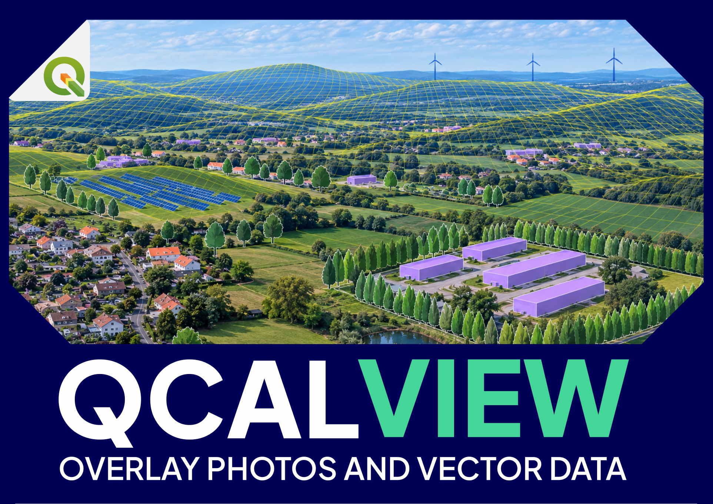

  

# QCALVIEW | 40.22

**Visual Simulation & Geomatics for QGIS**

QCALVIEW is an open-source QGIS plugin developed by **Fabrice Kerzerho - ArcTan°** for photographic viewpoint calibration, visual simulation, projected GIS overlays and rapid landscape representations directly inside QGIS.

- Project: https://qcalview.com
- ArcTan°: https://arctan.fr
- Contact: contact@arctan.fr

## Python dependencies

QCALVIEW uses NumPy and QGIS PyQt. Pillow (PIL) is optional and is used for EXIF metadata export; other functionality does not require EXIF writing.

## Rendering prerequisite

**Terrain raster required for rendering.** QCALVIEW requires an explicitly selected DEM/DTM/DSM raster in **Relief > Raster MNT/MNS** before any preview or visual export can be rendered. Merely having a raster in the QGIS project is not sufficient.

## Compatibility

- QGIS 3.44.x / Qt5
- QGIS 4.x / Qt6

## Release status

QCALVIEW 40.22 extends the stable QGIS plugin with Multi-View while retaining the 40.21 rendering and project-state behaviour. Core calibration, projected-layer, terrain, viewer and export workflows are available as regular plugin functionality. Some optional advanced tools remain explicitly marked as experimental and may still evolve. Results should always be checked on representative projects before production use.

The Experimental Tools tab currently exposes:

- Projection grid
- Azimuth ruler
- Interactive monoplotting

Other internal development modules remain unavailable in public builds.

## Multi-View (40.22)

QCALVIEW can open up to four viewpoint viewers simultaneously. Each viewer keeps its own temporary camera state and can be reassigned to another viewpoint. Clicking a viewer makes it active and synchronizes the QCALVIEW cockpit with that viewer.

Two presentation modes are available: independent windows and an integrated Quad View. Rendering remains centrally coordinated and sequential. Camera-only changes such as azimuth, pitch, roll or FOV refresh only the active viewer. Shared-scene edits, such as changes to projected QGIS objects, are propagated to the other open views through lightweight secondary passes followed by high-quality refinement. Heavy geometry/overlay caches remain shared by the QCALVIEW core, with a bounded cache of up to four decoded photo sources to avoid repeated disk decoding while switching terminals.

Each viewer provides **Save viewpoint state**, which writes the same parameters + visual state as the former dock button, but explicitly for the viewpoint assigned to that viewer. In Quad View the interface switches to a compact per-view command strip and hides the large information side panel; full controls remain available in separate-window mode. Multi-View layout, assigned viewpoints and temporary camera states are stored in the QGIS project.

## Absolute camera altitude and vertical reference (40.22)

The **Absolute alt. / Alt. absolue** checkbox next to **Alt./Z** switches the active viewpoint between the historical **DEM elevation + camera height** interpretation (unchecked, default) and a direct **absolute camera elevation** (checked). The mode is saved individually in the `qcv_altabs` field; use **Create QCALVIEW fields** for previously existing viewpoint layers.

In **Settings > Variables > Vertical reference**, use the **QGIS project vertical CRS** (default) or explicitly select a **vertical EPSG CRS for QCALVIEW**. The project setting must be valid before enabling absolute altitude. QCALVIEW never assumes that the DEM's horizontal CRS also defines its vertical datum. When DEM/camera vertical references differ, no height conversion or certified elevation comparison is performed. When the raster's vertical reference is unspecified, the reported difference (ΔZ) is *indicative only*.

QCALVIEW does not apply QNH, geoid or other vertical datum transformations. Always verify the source photo's elevation datum before using absolute heights.

**Language fix:** QCALVIEW translations are now scoped to the plugin, avoiding interference with QGIS native menus and context actions.

## Coordinate systems

A projected project CRS with metric units is recommended for QCALVIEW calculations. Source viewpoint and vector layers may use another correctly declared CRS, including geographic CRS such as EPSG:4326; QGIS on-the-fly transformation is used where supported.

## Current limitations

Pinhole rendering is currently the most mature path. Cylindrical and equirectangular rendering remain experimental, especially for very large scenes, dense textures, depth/occlusion and high-resolution output. Very large images, terrain models and dense vector layers can require substantial memory.

See [Current limitations](docs/limitations.md).

## Documentation

See `docs/`  or https://qcalview.com/DOCS/#/ for the user manuals, current limitations and licensing notes.

## Licence

QCALVIEW is licensed under the [GNU GPL v3.0 or later](LICENSE). Copyright © 2026 Fabrice Kerzerho - ArcTan°.

Redistributions should retain the applicable attribution described in [NOTICE](NOTICE). QCALVIEW, ArcTan° and their associated logos/visual identity are subject to the [trademark policy](TRADEMARKS.md).
